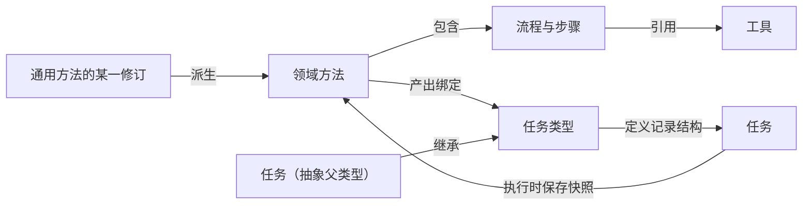

# 工作方法与任务类型的领域设计

工作方法把某个领域反复验证过的做法整理成可复用的流程。它定义步骤、执行人、验收人、输入、产出、验收条件、返工路径及执行所用的工具。任务类型定义要交付的任务属于哪一类，以及它需要哪些属性。

## 统一语言

| 领域概念 | 身份与职责 |
| --- | --- |
| 通用方法 | 可跨领域复用的工作方法。例如 OKR 定义目标、关键结果和复盘，敏捷研发定义从用户故事到独立验收的交付过程。以方法 ID 和修订号标识一个版本。 |
| 领域方法 | 为具体领域配置的工作方法，有自己的方法 ID 和修订。可以基于一版通用方法派生，再调整步骤、工具、角色、证据要求和返工路径。 |
| 方法步骤 | 工作方法修订中的一段流程。步骤在同一方法内有稳定标识，顺序属于该次修订。步骤声明输入、操作、输出、验收及允许的后续动作。执行者和复核者可以分别解析为成员、智能体或小队。 |
| 工具引用 | 方法步骤使用的技能、命令、应用或模板。引用保存工具类别、标识和适用版本，与所用步骤一同修订。运行时按工作区授权、执行身份和设备能力判断工具是否可用。 |
| 任务类型 | 任务多维表格的记录结构。配置专有属性、顺序、默认值、必填和公式。所有具体任务类型继承抽象父类型「任务」，包括普通任务。 |
| 任务 | 有独立身份的一份待交付工作。任务记录类型、字段值、状态、负责人及关联目标。任务采纳工作方法后，方法运行记录采用的修订、当前步骤和执行证据。 |
| 项目工作流 | 项目或工作区的任务状态、状态流转及交接规则。工作方法在执行中可以使用这些规则，把步骤进展同步到任务状态。 |

## 派生、产出与版本

通用方法到领域方法的关系是派生。派生时从已选来源修订复制，给领域方法独立的身份，并记录来源方法 ID、修订和适用领域。小幅调整可以发布为同一个领域方法的新修订。通用方法更新后，领域维护者比较来源版本并决定采纳哪些变更。已开始的任务沿用保存的方法快照。需要换版时显式记录采用的新修订和换版依据。

工作方法到任务类型的关系是产出或使用。工作方法可以为目标计划、某个步骤或返工指定任务类型。生成任务时，使用对应的任务类型校验字段，并保存发起任务的目标和方法上下文。方法可以产生不同类型的任务，也可以推进同一张任务的多个步骤。任务类型独立注册，可以直接用于新建任务和多维表格。多个领域方法可以使用同一类型，每个任务仍保存实际采用的方法与修订。明确的方法选择来自目标计划或发起者。自动绑定只在适用范围内有唯一结果时生效。

领域方法的工具引用随所用修订记录。执行者可以据此找到技能、命令或模板，再用正常权限运行。工具缺失时按该步的阻塞或替代条件处理，执行记录保留实际使用的工具和证据。

## 同一通用方法的领域用法

| 通用方法 | 领域方法 | 可调整的步骤、工具和证据 | 可能产生的任务类型 |
| --- | --- | --- | --- |
| 敏捷研发 | 第二大脑产品交付 | 用固定原件和跨身份样本确认权限。使用浏览器原型、Rust 测试和实际交互复验。 | 产品故事、缺陷修复、独立复验 |
| 敏捷研发 | 模型推理性能迭代 | 固定模型、量化、设备、数据集和基线。用 EvalScope 和引擎日志复跑首字时延、吞吐、质量与资源占用。 | 性能与基准评测、引擎优化、版本发布 |
| OKR | 个人知识系统目标管理 | 围绕真实资料管理场景定义关键结果。用固定资料回放证明可找回、可引用和跨身份可控。 | 目标规划、关键结果验证 |
| OKR | AI 基础设施目标管理 | 对齐受益项目和用户，固定质量、吞吐、延迟或成本口径。按评测报告和发布回执复盘。 | 目标规划、基准建立、回归评测 |

## XShadow 中的实现边界

| 现有入口或代码 | 保存的事实 |
| --- | --- |
| [任务类型定义](../server/internal/handler/issue_type.go) | 任务类型 ID、字段引用、必填、默认值、归档状态。 |
| [工作方法定义与执行](../server/pkg/workmethod/method.go) | 方法 ID 和修订、步骤、步骤验收、角色、最终评审、返工位置，以及方法运行快照。 |
| [方法的任务绑定](../server/internal/handler/work_method_templates.go) | `plan_task` 指定目标计划产生的类型，`rework_task` 指定重复返工的跟进类型，`table_gate` 指定步骤读取的任务公式。现有自动绑定按类型校验冲突。 |
| [设置页](../packages/views/settings/components/settings-page.tsx) | 「工作方法」展示方法目录、步骤及任务绑定。「任务类型」管理字段。「工作流」管理状态与流转。 |

领域方法的来源修订、稳定步骤标识、独立的步骤工具引用、任意步骤产出类型属于上述领域设计。现有步骤可在执行指南中引用工具，并支持 GitHub 交付配置。

## 可区分的验收场景

| 操作 | 预期 |
| --- | --- |
| 展开没有任务类型绑定的方法 | 可以查看和编辑该方法。展开一个独立任务类型，可以查看它的字段。 |
| 展开已有目标计划绑定、返工绑定和公式门槛的方法 | 能分别查到产出的任务类型与门槛读取的公式。修改方法步骤从「工作方法」进入。 |
| 基于敏捷研发 r15 派生模型推理方法，修改评测步骤 | 新方法有独立 ID，保留 r15 的来源引用。敏捷研发和其他领域方法保留原步骤。 |
| 发布模型推理方法 r2，同时保留一条按 r1 执行的任务 | 选用 r2 的任务读取新步骤和工具。原任务读取快照中的 r1，并保留原有证据。 |
| 按同一任务类型开一张普通任务，再从方法生成一张任务 | 两张任务按同一字段结构校验。由方法生成的任务还保存目标、方法和来源步骤等适用关联。 |
| 步骤指向当前执行者无权使用的工具 | 方法可展示该引用。执行权限由工具系统判断，步骤记录实际阻塞及恢复条件。 |
